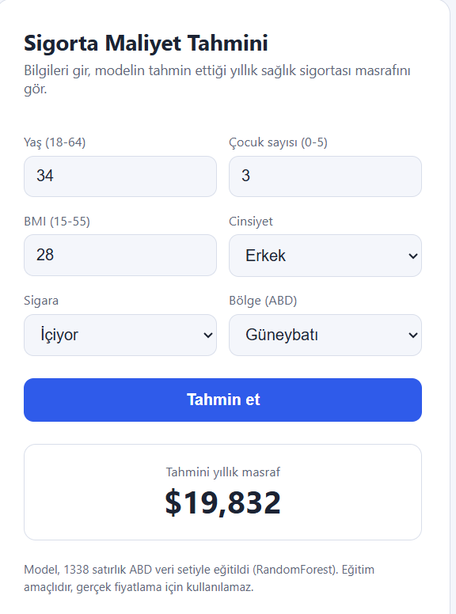

Canlı demo: https://...onrender.com
# Sigorta Maliyet Tahmini

Bir kişinin yaşı, BMI değeri, sigara içip içmediği gibi bilgilerinden yıllık sağlık sigortası masrafını tahmin eden bir makine öğrenmesi projesi. Modeli eğitmekle kalmadım: sonuçların güvenilir olması için veri sızıntısını ve overfitting'i engellemeye çalıştım, seçtiğim modeli FastAPI ile bir API'ye ve basit bir web sayfasına çevirdim, hepsini de Docker ile paketledim.

> Bu proje eğitim amaçlıdır. Model 1338 satırlık ABD verisiyle eğitildi, gerçek sigorta fiyatlaması için kullanılamaz.

## Veri

Kaggle'daki "Medical Cost Personal Datasets" (`insurance.csv`) kullanıldı. Sütunlar: yaş, cinsiyet, BMI, çocuk sayısı, sigara kullanımı, bölge ve tahmin etmeye çalıştığımız masraf (`charges`). Veri dosyasını repoya koymadım; çalıştırmak isterseniz Kaggle'dan indirip notebook'taki yola koymanız yeterli.

## Neyi nasıl yaptım

Bu projede asıl dikkat ettiğim şey, modelin skorlarının gerçekten güvenilir olmasıydı. Bunun için:

- **Önce böldüm, sonra öğrendim.** Tekrar eden satırları sildikten sonra veriyi train ve test olarak ayırdım. Bölmeden önce veri üzerinde hiçbir öğrenme yapmadım, böylece test setinden train'e bilgi sızmıyor.
- **Bölmeyi dengeli yaptım.** Sigara içenlerin masrafı çok daha yüksek olduğu için, bölerken `smoker` ve masrafın çeyrek dilimlerini birlikte dikkate aldım. Train ve test setinde sigara içen oranı ile masraf dağılımı birbirine yakın kaldı.
- **Ön işlemeyi modelin içine koydum.** Ölçekleme ve kategorik dönüşümler modelle aynı Pipeline'da. Çapraz doğrulamada her tur sadece kendi eğitim kısmından öğreniyor, doğrulama kısmını önceden görmüyor.
- **Skorları gerçek ölçekte hesapladım.** Masrafı log ile dönüştürerek eğittim ama sonuçları tekrar dolara çevirip öyle ölçtüm. Böylece CV ve test skorları aynı ölçekte, yani doğrudan kıyaslanabilir.
- **Test setine sonda bir kez baktım.** Model seçimi ve ayarları sadece çapraz doğrulamayla yaptım, test setiyle hiçbir karar vermedim.

Üç modeli karşılaştırdım: ElasticNet, RandomForest ve XGBoost. Her birinin ayarlarını (örneğin ağaç derinliği, minimum yaprak sayısı, düzenleyici parametreler) çapraz doğrulamayla aradım.

## Overfitting var mı?

Metriklere bakmadan önce her modelin eğitim, çapraz doğrulama (CV) ve test R² değerlerini yan yana koydum. Overfitting'i iki farkla ölçüyorum:

- **Eğitim - Test farkı:** Modelin eğitim verisindeki puanı ile hiç görmediği test verisindeki puanı arasındaki fark.
- **Eğitim - CV farkı:** Aynı kıyas, ama eğitim verisinin içinden ayrılan deneme parçalarıyla.

İki farktan biri 0,10'u geçerse modeli "overfit" sayıyorum.

| Model | Eğitim R² | CV R² | Test R² | Eğitim - Test farkı | Eğitim - CV farkı | Durum |
|---|---|---|---|---|---|---|
| ElasticNet | 0,805 | 0,797 | 0,852 | -0,047 | 0,008 | Normal |
| **RandomForest** | 0,872 | 0,849 | 0,883 | -0,011 | 0,023 | Normal |
| XGBoost | 0,872 | 0,845 | 0,883 | -0,011 | 0,027 | Normal |

Eksi işareti, modelin test verisinde eğitim verisinden bile biraz daha iyi puan aldığı anlamına gelir; yani ezber yok. Test seti küçük olduğu (268 satır) için küçük bir şans farkı normal.

"Eğitim R²", çapraz doğrulamanın her turunda modelin kendi eğitim kısmında aldığı puanın ortalamasıdır.

Ayar yapmadan önce RandomForest'ın eğitim-CV farkı yaklaşık 0,12, XGBoost'un yaklaşık 0,20 çıkmıştı; yani ikisi eğitim verisini ezberliyordu. Ayardan sonra bu fark 0,02-0,03'e düştü.

## Sonuçlar

Hatalar dolar cinsinden (test seti):

| Model | RMSE | MAE | R² |
|---|---|---|---|
| ElasticNet | 5110 | 2572 | 0,852 |
| **RandomForest** | 4553 | 1985 | 0,883 |
| XGBoost | 4550 | 1999 | 0,883 |

**Seçtiğim model RandomForest** (400 ağaç, maksimum derinlik 5, yaprakta en az 5 örnek). Overfit etmeyen modeller arasında çapraz doğrulamada en düşük hatayı verdi. XGBoost ile arasındaki fark çok küçük (yaklaşık %1), yani ikisi pratikte aynı seviyede; RandomForest'ı eğitim-doğrulama farkı daha düşük olduğu için seçtim.

ElasticNet'in geride kalmasının sebebi şu: sigara ve yüksek BMI birlikte olunca masraf bir anda sıçrıyor, doğrusal bir model bu eşik etkisini yakalayamıyor. Etkileşim terimleri ekledim ama fark kapanmadı.

## Nasıl çalıştırılır?

### Docker ile (en kolayı)

```
docker build -t sigorta-api .
docker run -p 8000:8000 sigorta-api
```

Sonra tarayıcıda `http://localhost:8000` adresini açın. Karşınıza bilgileri girebileceğiniz bir form çıkar. `http://localhost:8000/docs` adresinde de API'nin kendi arayüzünü görebilirsiniz.

### Docker olmadan

Python 3.12 ya da 3.13 yeterli.

```
pip install -r requirements.txt
python -m uvicorn app.main:app --reload
```

Küçük bir uyarı: Model scikit-learn 1.6.1 ile kaydedildi. Başka bir sürümle yüklenmeyebilir, bu yüzden `requirements.txt` içinde sürümleri sabit tuttum.

## API nasıl kullanılır?

`POST /predict` adresine şu bilgileri gönderiyorsunuz:

```json
{"age": 30, "sex": "male", "bmi": 28, "children": 1, "smoker": "yes", "region": "northeast"}
```

Karşılığında tahmini masrafı alıyorsunuz:

```json
{"predicted_charges": 19659.44}
```

Kabul edilen değerler: yaş 18-64, BMI 15-55, çocuk sayısı 0-5, cinsiyet `male` ya da `female`, sigara `yes` ya da `no`, bölge `northeast`, `northwest`, `southeast` ya da `southwest`. Bunların dışında bir şey gönderirseniz API hata döndürür. Sunucunun çalışıp çalışmadığını `GET /health` ile kontrol edebilirsiniz.

## Klasör yapısı

```
sigorta-projesi/
├── notebooks/sigortaprojesi_temiz.ipynb   # analiz ve model karşılaştırması
├── app/main.py                            # API ve web sayfası
├── models/best_model.joblib               # eğitilmiş model
├── Dockerfile
├── requirements.txt
└── README.md
```

## Sınırlamalar

- Veri seti küçük (1338 satır) ve sadece ABD'den.
- Masrafı log ile dönüştürerek eğittiğim için tahminler ortalamayı hafif düşük tahmin etme eğiliminde olabilir.
- `.joblib` dosyaları güvenilmeyen kaynaklardan yüklenmemeli. Bu dosya bu proje için üretildi.
